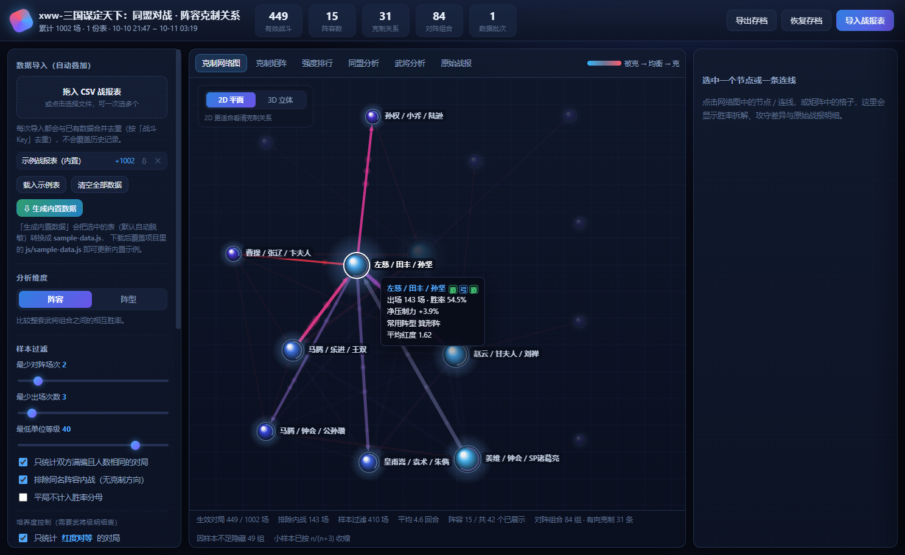
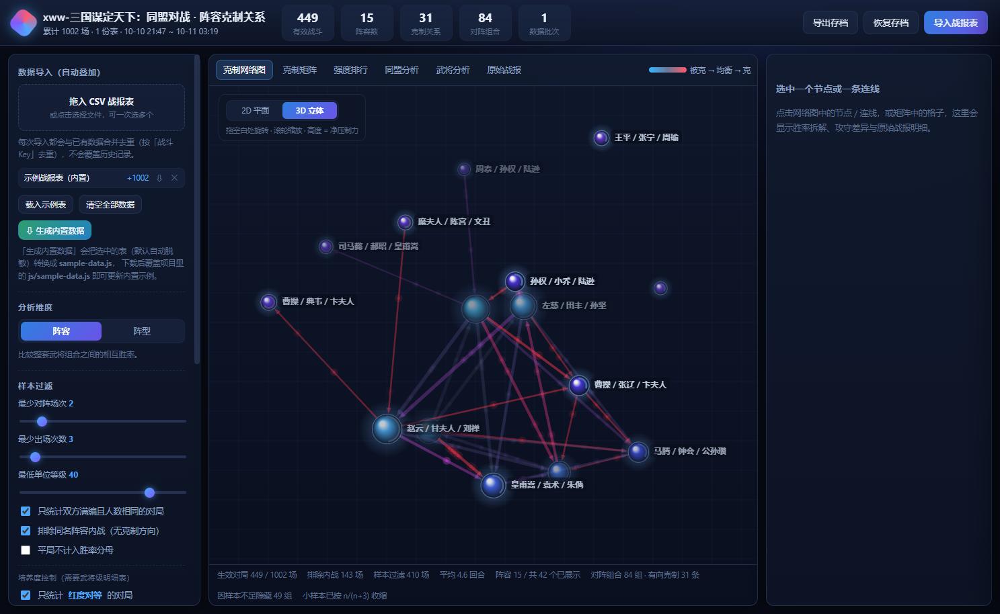
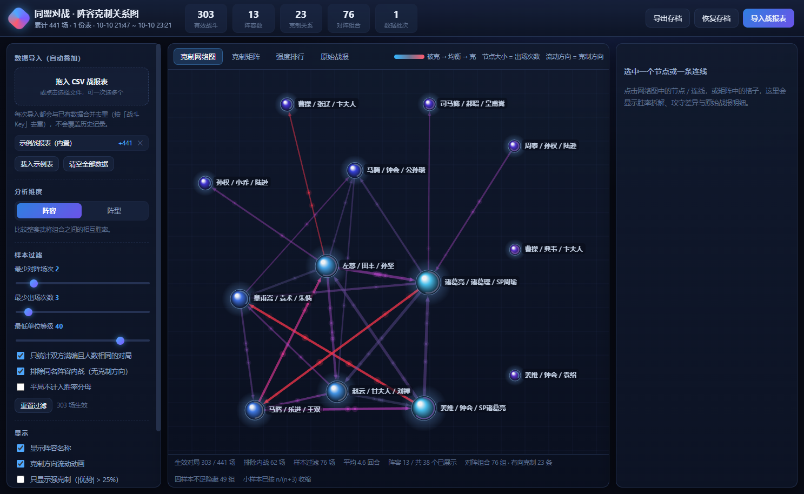
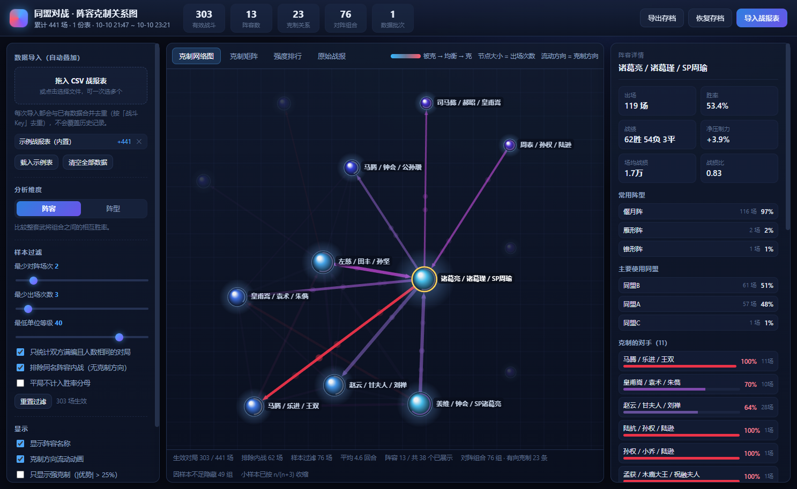
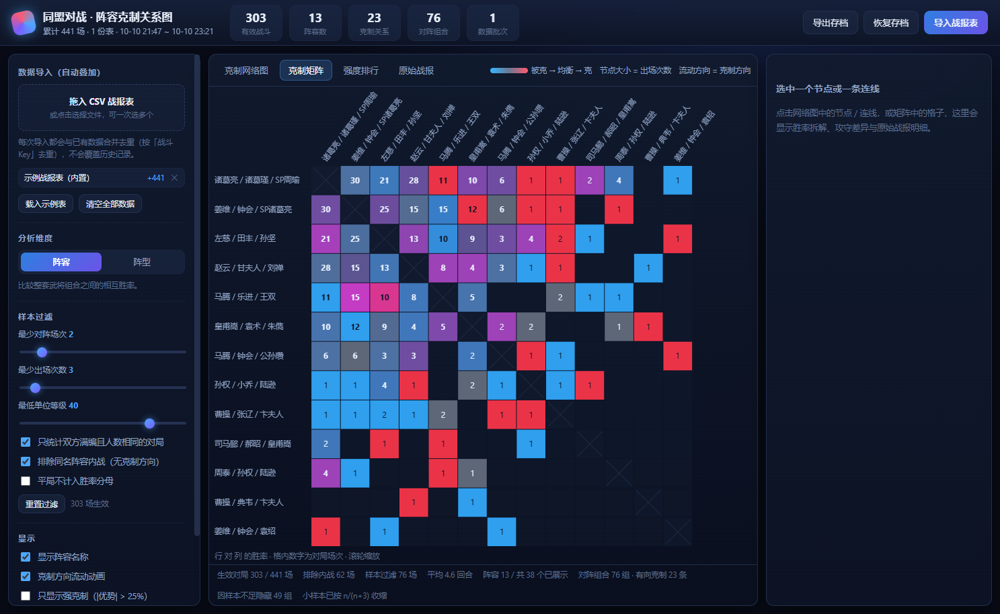
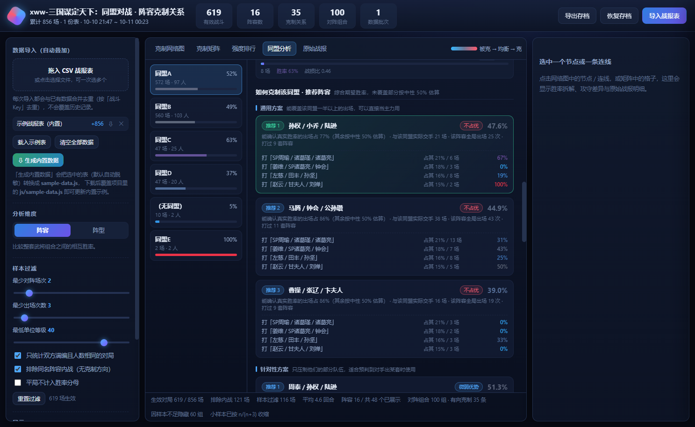
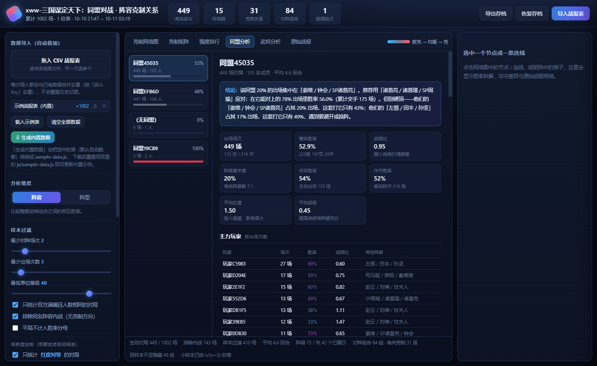
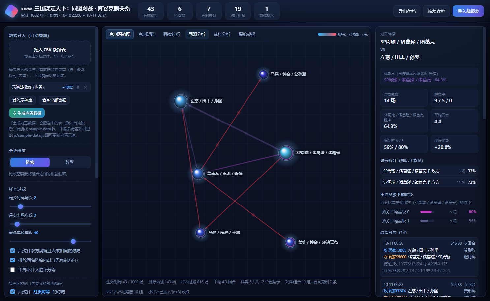
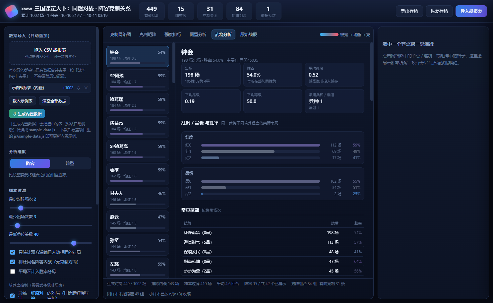

# 同盟对战 · 阵容克制关系图

读取 Sanmou 抓取的战报数据，自动算出**哪些阵容克哪些阵容**，并用带流动动画的关系图和克制矩阵展示。
统计口径按「一次出战 = 1 场」处理（同一场交战的续战段不重复计数），结论直接可读。

---

## 线上体验
[跳转去体验-线路1](https://laojingwei.github.io/alliance-counter) (可能数据加载比较慢)
[跳转去体验-线路2](https://alliance-counter.pages.dev) (推荐)

## 快速开始

**零依赖：拿到这个文件夹的人不需要安装任何东西** —— 不用 Node.js、不用 Python、不用打包工具。
整个文件夹可以复制到任意位置直接运行（所有引用都是相对路径）。

### 数据从哪来？

数据文件 js/battle-data.js 由配套工具 **[sanmou-viewer](https://github.com/laojingwei/sanmou-viewer)** 生成：

1. 打开 sanmou-viewer（本地服务），顶栏切到「战报数据」
2. 选「合并全部来源」→ 点「导出数据文件」，得到 battle-data_xxx.js
3. 把它重命名/复制为本项目的 js/battle-data.js
4. 跑 `node tools/split-battle-data.mjs` 分片（原因见下）
5. 刷新页面，数据自动载入并缓存（IndexedDB，下次秒开）

> **为什么要分片**：Cloudflare Pages（alliance-counter.pages.dev）限制单个资源文件最大
> **25 MiB**，而完整数据文件约 27 MiB，会让整个部署构建失败
> （`Error: Pages only supports files up to 25 MiB in size`）。
> 拆分后得到 `js/battle-data.1.js` … `battle-data.N.js`（每片默认 ≤ 14 MiB）和一个只有
> 几行的装载器 `js/battle-data.js`，由装载器合并回 `window.AC.battleData`——页面其余
> 代码只认这个变量，因此**没有任何改动**。只用本地 / GitHub Pages 时也可以不分片，
> 直接把完整文件放进 `js/` 同样可用。
>
> **脱敏**：如果要把数据连同仓库一起分发（如 GitHub Pages），
> 在 sanmou-viewer 导出时勾选「脱敏」，玩家名 / 同盟名会替换成一对一假名，
> 分析结论不变但无法反推真实名称。

### 打开方式

**方式一（推荐）**：直接双击 index.html，用浏览器打开（Chrome / Edge / Firefox 均可）。

**方式二（备选）**：极少数浏览器会限制 ile:// 页面的本地存储（例如某些版本的 Safari）。
遇到这种情况，双击 start-server.cmd，脚本会自动探测本机的 Node.js 或 Python 并开启
\http://127.0.0.1:8123/\；一个都没有时，脚本会明确提示直接双击 \index.html\ 即可。

> Node.js 只被 \	ools/\ 目录下的开发脚本使用（测试、审计等），**与页面运行完全无关**，
> 普通使用者可以忽略整个 \	ools/\ 目录。
>
> 自己载入的战报数据只存在本机浏览器里，不会上传到任何地方。

---

## 数据口径

| 概念 | 说明 |
| --- | --- |
| **block（主战报）** | 一次完整交战的最终结果，是统计的基本单位 |
| **child（续战段 / 团战分战报）** | 同一场交战内部的分段，**不计入统计**，只在明细里可见 |
| **合并链** | block 与其名下 child 按父战报关系合并：伤亡/回合/武勋累计，胜负取时间最末段 |

导入后侧边栏「数据源」面板会显示：总记录数、block / child 拆分、父战报匹配率、
玩家数、时间范围与数据文件导出时间。数字对不上时先看这里的「父战报匹配率」。

- **本地存储**：转换结果缓存在浏览器 IndexedDB（键名含版本号）。数据文件更新后点「重新载入」即可。
- **重新载入**：侧边栏「↻ 重新载入」会重新从 \window.AC.battleData\ 转换一遍；顶栏按钮同效。
- **清空数据**：只清浏览器缓存，数据文件本身不受影响，刷新后重新载入。

---


## 分析口径（这几条决定了结论是否可信）

默认过滤条件可以在左侧「样本过滤」里调，判定口径如下：

1. **阵容名归并**：`赵云 / 甘夫人 / 刘禅` 与 `刘禅 / 赵云 / 甘夫人` 视为同一阵容（武将顺序无意义，按武将名排序后作为 Key）。
2. **只统计满编对局**：默认过滤「双方都是 3 人且人数相同」的对局，排除 3 打 1 之类的刷分 / 残兵场。
3. **最低单位等级**：默认过滤掉任意一方有 40 级以下单位的对局（排除小号），避免污染胜率。
4. **排除内战**：同名阵容互打没有克制方向，默认不计入。
5. **消除先后手偏置**：同一对阵容的交手，无论谁是攻方都合并统计（在详情里再单独拆分「A 作攻 / A 作守」的胜率）。
6. **小样本收缩**：这是最关键的一条。只有 1 场 1 胜 0 负不能叫 100% 克制，所以胜率会向 50% 收缩：

   ```
   收缩胜率 = (原始胜率 × 有效场次 + 0.5 × K) / (有效场次 + K)      # K 默认 3
   克制强度 = 收缩胜率 - 50%
   ```

   场次越少越接近 50%（即"看不出克制"），场次越多越接近真实胜率。
   界面上显示的「样本置信」= `n / (n + K)`，可以直接看出这条关系有多少数据支撑。
7. **辅助指标**：除胜负外还统计**战损**（伤兵 + 阵亡，相对原始兵力），比单纯胜负更能反映"打得轻不轻松"。
8. **综合强度分 = 打击面 + 胜率 + 连胜 + 战损 + 劣势**（强度排行页 / 3D 高度用这个口径，满分 100）：

   给玩家看的「这套队伍到底强不强」，五个维度加权，权重就是它们对强度的解释力：

   | 维度 | 权重 | 怎么算 | 为什么看它 |
   | --- | --- | --- | --- |
   | **打击面** | 32% | 打赢过多少支**不同队伍**：对某支对手公平赢面 > 50% 且交手 ≥ 3 场才算「赢过」，合成量 = 赢过的种类数 + 优势加成 − 1（只赢 1 支 = 0 分） | 打赢一支可能只是针对，打赢十几支才说明对谁都能打 |
   | **胜率** | 26% | 公平压制力换算（只认势均力敌与以少打多，堆兵刷的不算） | 最基本的强弱 |
   | **连胜** | 15% | 这套阵容**打出的最高连赢场数**（某玩家一次出战连续打赢几场，连赢 2 场 = 25 分、3 场 = 50 分、5 场 = 85 分、7 场及以上 = 100 分），再乘**武勋成色系数** | 一波推过去能连吃几支队伍；成色决定这段连赢值不值钱 |
   | **战损** | 12% | 赢的场次里「我方掉兵 / 双方掉兵」，越接近 0 越省 | 赢一场掉兵少，才能继续连战 |
   | **劣势** | 15% | 兵力比对方少时的胜率（≥ 3 场），并对比自己的公平胜率 | 以少打多还能赢，是硬实力 |

   - **「一次出战」与「连胜」怎么定**（战报里没有连战场次，只能从兵力还原）：
     一支部队满兵出战，**赢一场后用剩下的兵接着打**——判定式是
     「**下一场的开战兵力 ≈ 这一场的剩余兵力 + 这一场的伤兵**」（1% 或 200 以内）就算同一次出战。
     **伤兵这一项是关键**：伤兵会在战后恢复，所以只比剩余兵力会漏掉大量真连战
     （实测 8010 对相邻场次里，带伤兵的等式有 57% 精确成立，只比剩余兵力只有 9% 命中）；
     **中间隔多久都不影响**（打一阵、撤下去补给、过很久再碰到，只要兵力接得上仍是同一次）。
     打输了、打平了，或者**再也没有能接上兵力的下一场**，本次出战结束，连胜段到此为止。
     同一个玩家可能同时操控多支部队，所以按「玩家 + 阵容」分开追踪，每场兵力只允许被一条链认领。
   - **分项参照线自动标定**：每项用当前数据的 p90（记满分）与 p25（记 0 分）两条线映射到 0~100，
     强队自然落在 80~100、中游 40~60、弱队 20~40，换赛季 / 换样本量都不用手调参数。
   - **样本不足会往中间压**：分项高于 60 分的部分按 n/(n+12) 折算（最多只保留一半），
     避免「打 5 场恰好连胜两次」的小样本刷到榜首；出场 < 15 场的阵容在排行里会标「样本少」。
   - 没有样本的分项不占权重（例如打开「只统计兵力接近」时根本没有以少打多的场次），
     剩下几项按比例重新归一化，不会因为缺一项就把所有阵容的总分一起压掉。
   - 排行页每行给出综合分 + 五个分项条 + 赢过 N/M 支 + 最长连赢 + 赢时战损，
     底部附口径与权重说明；选中阵容后右侧详情摊开五维拆解、连胜/战损/劣势明细。
   - **连赢成色（武勋）**：同样打出 N 连，含金量可能天差地别。用连赢段的**平均单场武勋**当质量系数：
     单场武勋几千几百 = 打的是残兵/低等级，成色只给 0~30 分；成色满分线 6000 武勋。实测连赢段的平均武勋 p10≈2400、p50≈3900、p90≈4500。
     例：司马懿/曹操/郝昭 打出过 4 连，但连赢平均武勋只有 **242** → 成色 1 分，连胜分被压到 1 分；
     诸葛亮/诸葛瑾/SP周瑜 4 连、平均武勋 3657 → 成色 45 分。旧版导出没有武勋列时不做成色折算（不误伤）。
   - 实测样本（3538 场 / 65 个阵容）：诸葛亮/诸葛瑾/SP周瑜 赢过 18/63 支 → 综合 74.7 分居首；
     姜维/钟会/SP诸葛亮 71.2 分；而「赢过 1/8 支、最长 2 连」的阵容只有 51.5 分——
     打击面窄、连赢能力弱，光靠单场胜率刷不到前面。

9. **培养度控制（明细数据专有）**：红度与品级是最大的混杂变量——一套阵容胜率高，很可能只是因为
   它总是**满红打白板**。所以默认开启「**红度对等**」：只统计双方平均红度接近（差值 ≤ 1）的对局，
   把靠投入碾压的场次剔出去，剩下的才是阵容本身的强弱。还可设置「双方最低平均红度」，只看高投入对局。

   > 实测数据里红度的威力：红度 0 的部队胜率仅 **25%**，红度 3 已到 **52%**。
   > 开启红度对等后，1002 场里只有 449 场进入统计——这 553 场正是"投入不对等"的噪声。

10. **培养度分层（比"对等"更进一步）**：光把红度对齐还不够——**同一对阵容在不同红度下可能是相反的克制关系**。
   所以左侧还有「克制关系按培养水平分层」开关，可切到 **低红 / 中红 / 高红** 三档，整张克制网络、矩阵、
   排行都会按该档位重算。品级同理。

   实测同一对阵容：

   | 档位 | 交手 | 「诸葛亮/诸葛瑾/SP周瑜」胜率 | 谁占优 |
   | --- | --- | --- | --- |
   | 全部（旧口径） | 73 场 | 48% | 姜维队占优 |
   | **低红** | 33 场 | **39%** | **姜维队压制** |
   | 中红 | 34 场 | 53% | 诸葛亮队占优 |
   | **高红** | 6 场 | **67%** | **诸葛亮队压制** |

   > 只报一个 48% 是不够的——它把两种相反的局面平均掉，等于什么都没说。

   对阵详情里也会自动列出**这对阵容在各红度档位下的胜负**，看清"什么水平下谁克谁"。

---

## 离线更新（连不上 GitHub 时）

有些网络环境访问不了 GitHub，这时可以走**离线包**：

### 分享方：打包

双击 `pack-release.cmd`（macOS 是 `pack-release.command`），会生成：

```
dist/
├─ alliance-counter-v<版本号>.zip    ← 发给别人的就是这个
└─ 更新说明.txt                       ← 一起附上
```

zip 内是一层目录 `alliance-counter-v<版本号>/`，结构与 GitHub 下载的一致，
所以**两种来源的包可以混用**。打包时会排除 `.git`、`node_modules`、`dist`、临时文件。

### 接收方：用本地 zip 更新

**两种用法（任选）**：

| 用法 | 操作 |
| --- | --- |
| **拖拽**（最省事） | 把 zip 直接拖到 `update-from-zip.cmd`（Mac 是 `.command`）上松手 |
| **双击** | 把 zip 放到项目根目录（或 `dist/`），双击 `update-from-zip.cmd` |

脚本会：解压 → 认出包内版本并和当前版本对比 → 备份 → 覆盖（只排除 `.git`）→ 提示刷新页面。

> **注意**：脚本只认**含 `index.html` 的 zip**，如果拖进去的不是本项目的包，会直接拒绝并告诉你原因。
> 更新完成后，用过的那几个文件（zip、备份目录）可以手动删掉。

---

## 一键更新脚本（推荐给别人用这个）

项目根目录下有两个脚本，**双击就能自动更新**，绕过"浏览器不能替换本地文件"的限制：

| 系统 | 脚本 | 双击运行 |
| --- | --- | --- |
| Windows | `update-windows.cmd` | 是 |
| macOS / Linux | `update-mac.command` | 是（首次可能需右键 → 打开） |

**脚本会做什么**

1. 从 `index.html` 的 `data-repo` 读取仓库地址（和网页共用同一处配置）；
2. 自动选择更新方式：
   - 目录是 git 仓库且有 remote → **`git pull`**（最快，只拉差异）
   - 否则 → **下载最新 zip 并覆盖**
3. 更新前后做三件安全措施：

| 措施 | 说明 |
| --- | --- |
| **整目录备份** | 更新前复制到旁边的 `<目录名>-backup-<时间>`，出问题直接还原 |
| **内置数据随包更新** | 包内自带脱敏战报数据（分片），覆盖后开箱即用；你自己拖入/上传的数据存在浏览器里，不受影响 |
| **保留仓库地址配置** | 覆盖后自动把 `data-repo` 写回 `index.html` |

**首次使用前**：确认 `index.html` 里的 `data-repo` 是你自己的仓库地址（不是 `YOUR-NAME` 占位符），
否则脚本会提示"还没有配置仓库地址"并退出。

**macOS 权限提示**：如果双击提示"无法打开，因为它来自身份不明的开发者"，
右键 → 打开，或到「系统设置 → 隐私与安全性」里点「仍要打开」一次即可。

---

## 网页上的「版本检查」

页面右上角的「**版本检查**」按钮：读取仓库里的 `version.json` 和本地版本对比。

| 状态 | 表现 |
| --- | --- |
| 有新版本 | 标题变蓝、列出更新内容，并**指引你去运行对应系统的更新脚本** |
| 已是最新 | 绿色提示，附当前版本的更新内容 |
| 检查失败 | 黄色提示并列出原因（没配仓库地址 / 没联网 / `file://` 跨域被拦） |

启动后 2 秒会**静默检查一次**：只在发现新版时给按钮加个小红点，不弹窗打扰。

> 网页本身不会自动更新——浏览器没有替换本地文件的权限。所以网页负责"**告诉你有没有新版**"，
> 脚本负责"**真正把文件换掉**"，两者配合。

---

## 别人能一键检查更新（发布到 GitHub 后）

页面右上角有个「**检查更新**」按钮：它会去仓库读 `version.json`，和本地版本对比，
有新版本就列出更新内容、给下载按钮和覆盖步骤。

> **先说清一个限制**：浏览器不允许网页替换本地文件，所以这个按钮做的是
> 「**检查 → 提示 → 下载**」，不会静默自动更新。如果你把项目部署到 **GitHub Pages**，
> 那访客每次打开就是最新版，根本用不到这个按钮——它主要是给**下载 zip 到本地用的人**准备的。

### 发布前配置一次

**1. 在 `index.html` 的 `<body>` 上填你的仓库地址**（目前是占位符）：

```html
<body data-repo="https://github.com/laojingwei/alliance-counter">
```

**2. 确认仓库根目录有 `version.json`**（项目里已经带了一份）。

### 以后每次发新版

`version.json` 是**唯一配置源**，改完跑一次同步脚本即可，不用再手工对三处：

```bash
# 方式一：只改 version.json（version / releasedAt / name / notes）后同步
node tools/bump-version.mjs

# 方式二：顺手把版本号也改了（发布日期自动更新）
node tools/bump-version.mjs 202610122200a
```

脚本会自动同步三处（漏一处就会「页面显示旧版本」或「浏览器拿到旧缓存」）：

| 文件 | 脚本做什么 |
| --- | --- |
| `version.json` | 写入新版本号与发布日期（方式二时） |
| `js/version.js` | 由 version.json 生成，页面通过它读取版本号（`app.js` 的 `BUILD` 不再手工维护） |
| `index.html` | 所有 `?v=` 缓存参数统一刷成新版本号，并自检是否一致 |

忘了跑脚本也不怕：`node tools/test-dom.mjs .` 会逐项校验这三处是否一致，不一致直接 FAIL。

`version.json` 的 `notes` 会原样显示在更新面板里，所以**写清楚改了什么**，
别人一看就知道要不要更新、更新后有什么新东西。

### 按钮的三种状态

| 状态 | 表现 |
| --- | --- |
| 有新版本 | 标题变蓝、列出更新内容、给「下载最新版 (zip)」和「打开仓库」按钮，并说明覆盖哪些文件 |
| 已是最新 | 绿色提示，附当前版本的更新内容 |
| 检查失败 | 黄色提示并列出原因（没配仓库地址 / 没联网 / `file://` 被跨域拦截），并给「手动打开仓库」入口 |

启动后 2 秒会**静默检查一次**：只在发现新版时给按钮加个小红点，不会弹窗打扰。

---

## 看不到新功能？（缓存问题）

改完代码后浏览器可能仍用缓存的旧 js/css，表现是**功能没变化**（比如兵种徽章不显示）。
判断方法很简单——**看标题右边的版本小标签**：

| 标题旁显示 | 含义 | 处理 |
| --- | --- | --- |
| `v20261011d` | 已是最新代码 | 正常 |
| `v20261011d · 样式是旧缓存` | JS 是新的，但 CSS 被缓存了 | 按 **Ctrl+F5** 强制刷新 |
| 完全看不到版本标签 | 连 `index.html` 都是缓存的 | 按 **Ctrl+F5** 强制刷新 |

强制刷新：**Ctrl+F5**（或 Ctrl+Shift+R）。360、QQ 这类浏览器如果还不行，
到「设置 → 清理上网痕迹 → 清除网页缓存」清一次，或者关掉所有本页标签重新打开。

> 项目已经做了两层防护：所有 js/css 引用都带 `?v=版本号`，`index.html` 里也声明了
> `Cache-Control: no-cache`。但 `file://` 本地打开时，浏览器对 `index.html` 本身的缓存
> 有时不受这些约束，**强刷一次**是最可靠的办法。

---

## 兵种展示

武将级明细表里每个武将都带兵种（枪兵 / 弓兵 / 骑兵 / 盾兵），项目会把它贯穿到所有涉及阵容的地方：



- **网络图属性面板**：阵容名后面直接跟兵种徽章，如 `左慈 / 田丰 / 孙坚 [盾][弓][盾]`
- **部队级兵种串**：按武将顺序拼成 `盾弓盾`、`弓弓枪` 这样的速记串（与你说的「枪弓弓」一致）
- **对阵详情 / 强度排行 / 同盟分析 / 单点克制**：阵容名后都带徽章
- **原始战报**：攻守双方阵容列写成 `曹操 / 典韦 / 卞夫人（盾枪弓）`
- **武将分析**：单个武将给出**具体兵种全名** + 徽章（如 `[盾] 盾兵`），左侧列表也带徽章
- **网络图连线提示**：`A [盾弓盾] 克 B [枪盾盾]`

徽章按兵种配色，扫一眼就能分辨：**枪**（橙）、**弓**（蓝）、**骑**（紫）、**盾**（绿）。

> 兵种基本是武将的固有属性（79 名武将里只有 1 名出现过两种兵种），所以阵容的兵种串很稳定，
> 可以直接当作阵容特征来记。数据里没有兵种列（例如旧版宽表）时，整套展示会自动隐藏，不影响其它功能。

---

## 装备 · 战马 · 兵书分析

明细表里每个武将都带装备、战马、兵书，这一页把它们逐个量化（胜率 = 佩戴 / 携带者所在部队的胜负）：

| 区块 | 说明 |
| --- | --- |
| **特技** | 装备特技、战马特技各自的表现（至少 3 场） |
| **特效** | 装备特效、战马特效各自的表现 |
| **属性高低对胜率的影响** | 把装备 / 战马的**武力 / 智力 / 统率 / 速度**分档，并摊开**实际数值范围、取值种数**与**具体取值排行**——不光看趋势，还能看到到底是哪些数值在起作用 |
| **装备与战马** | 按胜率排序，至少 5 场 |
| **兵书** | 先按**品级**分组（善本 / 手抄 / 残章 / 上卷下卷），再列具体兵书 |

实测（真实战报数据）——**属性确实与胜率正相关**：

```
装备智力   <7 → 44%   7~9 → 47%   9~11 → 57%   ≥11 → 56%
装备速度   <7 → 44%   7~9 → 45%   9~11 → 53%   ≥11 → 58%
战马智力   <5 → 52%   5~7 → 48%   7~9 → 51%    ≥9  → 61%
战马统率   <5 → 41%   5~7 → 47%   7~9 → 49%    ≥9  → 59%
```

兵书品级差距也很明显：**善本 51%（10142 场）**，而手抄 36%（147 场）、残章 42%（24 场）。

---

## 内战分析（同队伍不同配置）

内战 = **同一套阵容对同一套阵容**。这是唯一能把「阵容」这个变量控制住的场景：
既然双方阵容相同，胜负就只能由**别的因素**决定。这一页专门回答你的问题——

> 同一队不同配置（装备、战马、技能）、不同红度品级，内战时谁更占优？

**左侧**：有内战的阵容列表，附先手胜率与兵种徽章。
**右侧**（选中阵容后）：

| 区块 | 说明 |
| --- | --- |
| 概览 | 内战场次、**先手胜率**（先后手影响有多大）、红度/品级更高方胜率 |
| **维度影响排行** | **核心**：逐个维度（红度、品级、武将等级、技能品级、装备/战马的武力智力统率速度、开战兵力…）比较双方谁更高，看「更高的一方」赢了多少，**按影响大小排序**，一眼看出哪个维度最关键 |
| **逐场对比** | 每一场的双方实际数值与差值，绿色=更高、红色=更低，能直接看出胜方是不是「配置更高」 |
| 红度差曲线 | 横轴 = 攻方红度 − 守方红度，纵轴 = 攻方胜率 |
| 品级差 | 品级更高方 / 较低方 / 相当，各自的样本与胜率 |
| 装备 / 战马 | 每件装备/战马的**佩戴者内战胜率**（至少 3 场才收录） |
| 技能 | 每个技能的**携带者内战胜率** |

> 数据源用的是**原始战报**，不受主分析「排除同名阵容内战」开关的影响——
> 否则这一页就没有数据了。

实测（真实战报数据）：**开战兵力 +23%**（更高方胜率 73%）、**品级 +20%**、**红度 +10%**；而战马智力 -12%（更高反而输得多，值得留意）。先手胜率 50.9%，说明先后手影响不大——

原始记录：
而**红度更高方胜率 60.6%**、**品级更高方 56.3%**——同样阵容，培养度就是硬实力。

---

## 3D 视图（可选，一键切换）

克制网络图左上角有 **2D 平面 / 3D 立体** 切换，两种模式共用同一套力学与渲染管线，可随时来回切。

**3D 里的第三根轴不是摆设**：z 轴 = **综合强度分**（打击面 / 胜率 / 连胜 / 战损 / 劣势五维加权）。碾压别人的阵容浮在上层，挨打的沉在下层，
一眼就能看出"谁在上面统治、谁在底下挣扎"。如果 z 轴只是力学随机推出来的，那 3D 就纯粹是花架子，
还更难看清——所以这根轴必须承载信息。

| 操作 | 说明 |
| --- | --- |
| 拖拽空白处 | 旋转视角（上下俯仰、左右环绕） |
| 拖拽节点 | 移动节点（会自动弹回它该在的强度层） |
| 滚轮 | 缩放 |
| 双击 | 视角复位 |
| 点击 | 选中节点 / 连线，和其他视图一样 |

渲染上有几个关键处理：

- **透视投影**：远处的节点自动变小（实测缩放比 0.85~1.12），产生纵深感
- **空气透视**：远处的节点更暗（雾化系数 0.38~0.89）、连线更淡，这是"看起来像 3D"的关键
- **深度排序**：Canvas 2D 没有深度缓冲，靠每帧按深度排序绘制来实现正确遮挡（远的先画）
- **屏幕空间拾取**：点击检测直接用投影后的坐标比距离，不需要反投影，和 2D 一样准



> 2D 和 3D 各有各的用处：**2D 信息密度更高、不容易看错，适合日常分析**；
> **3D 适合看整体结构（谁强谁弱的分层）和汇报展示**。切换按钮就在画布左上角，随时切。

---

## 六个视图

| 视图 | 用途 |
| --- | --- |
| **克制网络图** | 力导向布局。节点大小 = 出场次数，球体外的环 = 该阵容总体胜率。箭头方向 = 克制方向，箭头上的流动粒子越粗越快表示克制越明显。悬停高亮、点击聚焦、拖拽节点、滚轮缩放、双击重新布局。**支持 2D / 3D 切换**，见下文。 |
| **克制矩阵** | 行 × 列 = 同一批阵容，格子颜色 = 「行」打「列」的胜率（红=优势，蓝=劣势），格内数字 = 对局场次。格子大小自适应，滚轮可缩放。 |
| **强度排行** | 按「**综合强度分 = 打击面 + 胜率 + 连胜 + 战损 + 劣势**」排序（0~100，权重 32/26/15/12/15）：赢过的队伍越多、越能连赢、越省兵、越能少打多，分越高。每行给出综合分条 + 五个分项条 + 赢过 N/M 支 + 最高连赢 + 赢时战损，底部附口径说明。 |
| **同盟分析** | 逐个同盟的出战画像 + **反制建议**：主流队伍、惯用阵型、主力玩家、活跃时段，以及「用哪套阵容打这个同盟期望胜率最高」。详见下文。 |
| **武将分析** | 逐个武将的战绩与配装：出场、胜率、平均红度 / 品级、常带技能、兵书、装备、战马、最佳搭档、对阵表现，并附技能榜、特技特效榜与装备榜。**需要武将级明细表**（见下文）。 |
| **内战分析** | 同一套阵容的镜像对拼：先后手影响、红度/品级差对胜负的作用、装备战马技能的内战胜率。详见下文。 |
| **装备兵书** | 特技 / 特效 / 装备 / 战马 / 兵书的胜率排行，以及武力智力统率速度分档对胜率的影响。详见下文。 |
| **原始战报** | 过滤后的逐条对局明细（分页）。 |

点击网络图节点 / 连线、矩阵格子、排行行，右侧会显示详情：
阵容的出场、胜率、战绩、**综合强度分与五维拆解**、场均战损、战损比、常用阵型、主要使用同盟、**克制的对手**与**被克制的对手**清单，以及原始对局明细。

### 两个分析维度

- **阵容**：比较整套武将组合之间的相互胜率。
- **阵型**：比较鱼鳞 / 箕形 / 偃月 / 雁形 / 方圆 / 钩行 / 锥形等阵型之间的相互胜率（同一套分析逻辑复用）。

---

## 同盟分析怎么算的

左侧列出所有同盟（按出场量排序），右侧是选中同盟的完整画像。

**出战画像**

| 指标 | 含义 |
| --- | --- |
| 主流队伍 | 该同盟每套阵容的出场占比、胜率、战损比、惯用阵型；占比高说明这套是他们的主力 |
| 阵容集中度 | 最常用阵容的占比 + 有效阵容数（`1 / Σ占比²`）。集中度高 = 容易被针对 |
| 作攻 / 作守胜率 | 分辨这支同盟是主动出击型还是防守型 |
| 主力玩家 | 出场最多的成员及其惯用阵容，可看出谁在扛线 |
| 惯用阵型 | 哪个阵法用得多、胜率如何 |
| 活跃时段 | 按小时统计的出场分布，避开或专挑他们的高峰时段 |

**反制建议（核心）**

对每一个候选阵容，按该同盟的出场分布加权，算出**条件胜率**：

```
条件胜率 = Σ(该同盟用某队伍的占比 × 候选阵容打该队伍的胜率) ÷ Σ(这些占比)
          └─ 分母只取「双方真正交手过」的部分，镜像（同名内战）与没交手过的都不计入
```

**这里的关键修正**：早期版本把「没有交手数据」的场次按 50% 填充，等于把"没打过"当成"打不过"。
结果所有候选的胜率都被一起压到 45% 上下，结论永远是"压不住"，推荐出来的阵容也没法用。
现在改成**覆盖面用硬门槛保证、胜率只反映真实交手**，两条腿分开走路。

| 规则 | 取值 | 作用 |
| --- | --- | --- |
| 覆盖面硬门槛 | 至少能对上该同盟 **35%** 的出场 | 防止"只打过两套队伍"的窄覆盖阵容入选 |
| 打击面门槛 | 候选阵容全局出场 **≥ 5 次** | 排除冷门阵容 |
| 单场对阵收缩 | 每场对阵向 50% 做小样本收缩 | 避免「2 场全胜」被当成 100% |
| 证据量收缩 | 按实交手场次温和收缩 | 证据越少结论越保守 |
| 镜像处理 | **允许**对方主力阵容入选 | 镜像对拼是真实选项；内战部分无对抗数据，单独标注 |

推荐分两组，**通用方案（能对上 ≥60% 出场）永远排在针对性方案（35%~60%）前面**；
组内按条件胜率排序，同分时优先覆盖面更广、打击面更大的。
每张卡片都会列出：**能评估多少出场、实交手多少场、镜像占比、该阵容的全局出场与胜率、打过多少套阵容**，
并展开逐队伍明细（打某套队伍占其多少出场、交手几场、胜率多少）。

**每条推荐都自带风险提示**：只报喜不报忧会害人——推荐一套阵容，就必须同时告诉使用者
**对方哪几套队伍能压制它**。所以卡片下方会列出「⚠ 用它要当心这几套」，
按对方使用频率排序（越常用越要紧），点一下可直接跳到网络图看该阵容的克制关系。
结论文案里同样会带上，例如：

> 推荐用「诸葛亮 / 诸葛瑾 / SP周瑜」应对：在它能对上的 78% 出场里胜率 56.0%（累计交手 175 场）。
> **但别硬顶——他们的「姜维 / 钟会 / SP诸葛亮」占其 20% 出场，这套打它只有 43%**，遇到要避开或换阵。

**逐队伍单点克制**：针对它的每套主流队伍，列出最能压制它的阵容。这里同样有打击面门槛，
并按**收缩后的胜率**排序（避免 2 场全胜压过 20 场赢 65%），不足 5 场的会标注「样本少」。

> 计算胜率用的是**全局对抗数据**（不限该同盟的交手），所以样本量比只看该同盟的对局大得多，结论更稳；
> 而权重用的是该同盟自己的出场习惯——两者结合才是「打他们该出什么」。

---

## 武将分析怎么算的

这一页需要**武将级明细表**（一场战斗拆成多行，每行一个武将）。导入这种表后，项目会自动把它聚合成战斗记录，
再把武将级信息（技能、兵书、装备、战马、红度、觉醒、兵种）挂到每支部队上，所以前面的阵容克制分析照常可用。

**胜率口径统一为「该武将（或技能）在场时，其所在部队的胜负」**，这样不同维度可以直接横向比较。

| 内容 | 说明 |
| --- | --- |
| 武将战绩 | 出场、胜率、胜负平、**平均红度 / 品级 / 等级**、常用兵种与编组、主要所属同盟 |
| **红度 / 品级 曲线** | 该武将从红0到红5、从品0到品3各自的场次与胜率——直接看出投入值不值 |
| 常带技能 | 该武将带过的技能（含品级）及各自的场次与胜率——看出同一武将不同配法的强弱 |
| 兵书 / 装备 / 战马 | 该武将的常见搭配及其胜率 |
| 最佳搭档 | 同队出场 ≥3 场的其他武将，按胜率排序；点一下可跳到该武将 |
| 对阵表现 | 该武将对不同对手阵容的胜率，点一下可跳到网络图聚焦那套阵容 |
| 技能强度榜 | 全局技能按携带场次排序，附携带者胜率与平均品级 |
| 特技 / 特效强度榜 | 装备与战马的特技、特效各自的表现 |
| 装备 / 战马强度榜 | 同上，用于比较装备与战马的实战表现 |

> 技能名里的等级（如 `草船借箭(Lv10)`）会被拆出来单独统计，所以同一技能的不同等级会归并在一起比较；
> 每个技能的品级（`技能N品`）也会一并展示。

红度与品级同时贯穿到其他视图：**原始战报**里有「攻方/守方 红度·品级」列，
**强度排行**里有「均红度」列，**同盟分析**里有「平均红度 / 平均品级」和红度画像，
对阵详情与网络图节点提示也会显示培养度。

---

## 界面预览

克制网络图（节点大小 = 出场次数，箭头 = 克制方向，粒子沿线流动）：



点击节点后的聚焦高亮与详情面板：



克制矩阵（行打列的胜率，格内为对局场次）：



同盟分析（主力玩家 / 主流队伍 / 反制推荐 / 单点克制 / 活跃时段）：



反制推荐的实际效果（条件胜率 + 覆盖面 + 镜像标注 + **风险提示** + 逐队伍明细）：



对阵详情里的培养度分层（同一对阵容在不同红度下谁克谁）：



武将分析（战绩、配装、技能榜、装备榜）：



---

## 数据脱敏

脱敏在 **sanmou-viewer 导出时完成**（勾选「脱敏」选项）：玩家名替换为 `玩家0001`…
同盟名替换为 `同盟001`…，同一原名永远对应同一假名，统计结果不变但无法反推真实名称。

要把数据随仓库分发（如 GitHub Pages / Cloudflare Pages）时务必使用脱敏版。
本项目已把**脱敏后**的数据连同仓库一起分发（`js/battle-data.1.js`、`js/battle-data.2.js`
与装载器 `js/battle-data.js`），这样部署出来开箱就有数据；`.gitignore` 里保留了
「不进仓库」的注释行，若改成不分发，取消注释并同步本节说明即可。

---

## 项目结构

```
alliance-counter/
├─ index.html             页面入口（<script src> 引入数据与逻辑）
├─ start-server.cmd       备选本地服务（file:// 存储受限时用）
├─ css/style.css          深色主题样式
├─ js/
│  ├─ battle-data.js      战报数据装载器（合并下面的分片，勿手改）
│  ├─ battle-data.1.js    ★ 战报数据分片 1（viewer 导出后由 split-battle-data.mjs 拆分）
│  ├─ battle-data.2.js    ★ 战报数据分片 2
│  ├─ sanmou-source.js    数据装载：battleData → 内部 battle 结构
│  ├─ model.js            阵容标准化、父战报串链、多段合并
│  ├─ store.js            IndexedDB 缓存
│  ├─ analyzer.js         统计口径（一次出战=1场）、克制关系、强度分
│  ├─ graph.js / matrix.js / rank.js / table.js   克制网络图 / 矩阵 / 排行 / 明细表
│  ├─ alliance.js / heroes.js / mirror.js / gear.js / player.js   五个分析视图
│  ├─ app.js              界面装配与交互
│  └─ util.js / version.js / update.js            工具 / 版本 / 更新检查
├─ tools/                 开发脚本（与页面运行无关）
└─ version.json           版本信息（update.js 读取）
```

## 开发者工具

```powershell
# 端到端 DOM 冒烟测试（临时静态服务 + jsdom + 假画布）
node tools/test-dom.mjs .

# 强度排行口径验证（合成数据 + 真实数据回归）
node tools/test-strength.mjs

# 玩家分析审计（合成数据，含性能基线）
node tools/audit-player.mjs

# 版本号生成（改 version.json 后运行）
node tools/bump-version.mjs

# 战报数据分片（viewer 导出完整文件后运行；Cloudflare Pages 单文件上限 25 MiB）
node tools/split-battle-data.mjs
```

测试数据说明：`tools/` 下的测试默认读取 `js/battle-data.js` 做真实数据回归
（分片时会自动按 `battle-data.1.js` → `battle-data.2.js` → 装载器的顺序加载）；
没有该文件时合成数据部分照常运行。

---

## 调整建议

- 数据量还小时，把「最少对阵场次」降到 1~2，能看到更多关系（但置信度低）。
- 想只看最硬的克制关系，勾上「只显示强克制（|优势| > 25%）」。
- 阵容很多时把「最多展示阵容数」调大，或直接用「克制矩阵」视图看全量。
