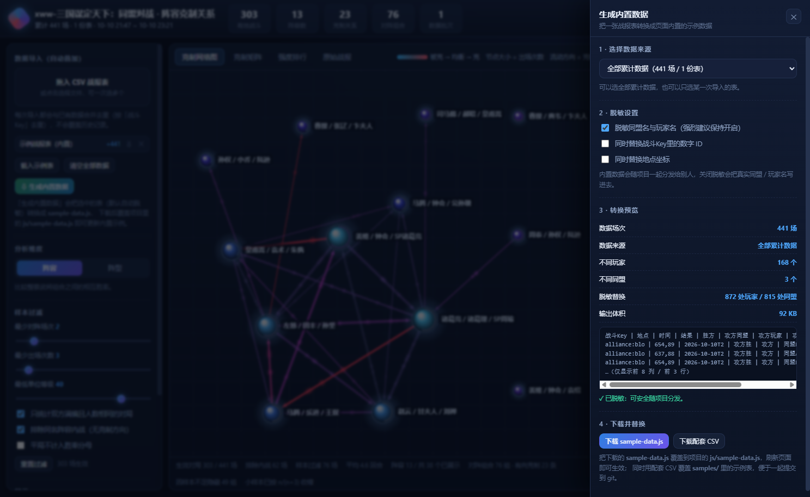

# 同盟对战 · 阵容克制关系图

把战报 CSV 拖进来，自动算出**哪些阵容克哪些阵容**，并用带流动动画的关系图和克制矩阵展示出来。
多次导入的战报会**自动叠加**（按「战斗Key」去重），数据存在浏览器本地，越攒越准。

---

## 快速开始

**零依赖：拿到这个文件夹的人不需要安装任何东西** —— 不用 Node.js、不用 Python、不用打包工具。
整个文件夹可以复制到任意位置直接运行（所有引用都是相对路径）。

**方式一（推荐）**：直接双击 `index.html`，用浏览器打开（Chrome / Edge / Firefox 均可）。
点击左侧「载入示例表」即可看到完整效果；也可以把战报 CSV 拖到页面任意位置导入。

**方式二（备选）**：极少数浏览器会限制 `file://` 页面的本地存储（例如某些版本的 Safari）。
遇到这种情况，双击 `start-server.cmd`，脚本会自动探测本机的 Node.js 或 Python 并开启
`http://127.0.0.1:8123/`；一个都没有时，脚本会明确提示直接双击 `index.html` 即可。

> Node.js 只被 `tools/` 目录下的开发脚本使用（脱敏、测试、数据画像等），**与页面运行完全无关**，
> 普通使用者可以忽略整个 `tools/` 目录。
> 演示地址参数：`index.html?demo=1` 会自动载入内置示例表并跳过提示。

> **内置示例数据已脱敏**：示例表与 `js/sample-data.js` 中的同盟名、玩家名均已替换为一对一假名
> （同盟 → `同盟A/同盟B/…`，玩家 → `玩家01`…，同一原名永远对应同一假名），
> 因此分析结论与真实数据完全一致，但无法反推真实名称。
> 当前内置的是**武将级明细表**：1002 场战斗 / 5765 条武将记录 / 79 名武将 / 260 种技能。
> 自己导入的真实战报表只存在本机浏览器里，不会上传到任何地方。

---

## 导入与叠加

| 操作 | 说明 |
| --- | --- |
| 拖拽文件到页面 | 支持一次拖多个 CSV |
| 点击「导入战报表」 | 从文件选择器选一个或多个 |
| 「载入示例表」 | 载入内置的一份样例数据 |
| 「导出存档」 | 导出 JSON，换电脑 / 换浏览器时备份 |
| 「恢复存档」 | 把 JSON 存档叠加回来（同样去重） |

- **叠加而非覆盖**：新导入的记录会与已有记录合并，重复的战斗（同 `战斗Key`）自动跳过，不会重复计数。
- **可回滚**：左侧「数据导入」区会列出每次导入的批次，点条目右侧的 `✕` 可以只移除那一批。
- **支持两种表**：
  1. **宽表**：一场战斗一行（约 29 列，含攻守双方的阵容 / 阵型 / 兵力）；
  2. **武将级明细表**：游戏导出的明细数据（74 列左右，一场战斗拆成多行，每行一个武将）。
     程序会自动识别并聚合成战斗记录，同时保留武将、技能、兵书、装备、战马、红度、觉醒等信息，
     供「武将分析」使用。判断依据是表头里是否同时出现「武将序号 / 武将名 / 方 / 战斗编号」这类列。
- **表头自动识别**：列名和列顺序可以不一样。程序先做别名匹配，再按关键词推断（`攻/atk/attacker`、`守/def/defender` × `阵容/team`、`阵型/formation`、`等级/level`…）。
  已支持中英文列名、逗号 / 制表符 / 分号分隔、UTF-8 与 GB18030 编码（游戏导出的 GBK 表也能直接读）。
- **本地存储**：数据保存在浏览器 `localStorage`（键名 `ac.battles.v2`）。清空浏览器数据会丢，重要数据请用「导出存档」备份。

识别不到的列会在导入后提示，不影响已识别字段的使用。

---

## 分析口径（这几条决定了结论是否可信）

默认过滤条件可以在左侧「样本过滤」里调，判定口径如下：

1. **阵容名归并**：`赵云 / 甘夫人 / 刘禅` 与 `刘禅 / 赵云 / 甘夫人` 视为同一阵容（武将顺序无意义，按武将名排序后作为 Key）。
2. **只统计满编对局**：默认过滤「双方都是 3 人且人数相同」的对局，排除 3 打 1 之类的刷分 / 残兵场。
3. **最低单位等级**：默认过滤掉任意一方有 40 级以下单位的对局（排除小号），避免污染胜率。
4. **排除内战**：同名阵容互打没有克制方向，默认不计入。
5. **消除先后手偏置**：同一对阵容的交手，无论谁是攻方都合并统计（在详情里再单独拆分「A 作攻 / A 作守」的胜率）。
6. **小样本收缩**：这是最关键的一条。只有 1 场 1 胜 0 负不能叫 100% 克制，所以胜率会向 50% 收缩：

   ```
   收缩胜率 = (原始胜率 × 有效场次 + 0.5 × K) / (有效场次 + K)      # K 默认 3
   克制强度 = 收缩胜率 - 50%
   ```

   场次越少越接近 50%（即"看不出克制"），场次越多越接近真实胜率。
   界面上显示的「样本置信」= `n / (n + K)`，可以直接看出这条关系有多少数据支撑。
7. **辅助指标**：除胜负外还统计**战损**（伤兵 + 阵亡，相对原始兵力），比单纯胜负更能反映"打得轻不轻松"。
8. **培养度控制（明细数据专有）**：红度与品级是最大的混杂变量——一套阵容胜率高，很可能只是因为
   它总是**满红打白板**。所以默认开启「**红度对等**」：只统计双方平均红度接近（差值 ≤ 1）的对局，
   把靠投入碾压的场次剔出去，剩下的才是阵容本身的强弱。还可设置「双方最低平均红度」，只看高投入对局。

   > 实测数据里红度的威力：红度 0 的部队胜率仅 **25%**，红度 3 已到 **52%**。
   > 开启红度对等后，1002 场里只有 449 场进入统计——这 553 场正是"投入不对等"的噪声。

9. **培养度分层（比"对等"更进一步）**：光把红度对齐还不够——**同一对阵容在不同红度下可能是相反的克制关系**。
   所以左侧还有「克制关系按培养水平分层」开关，可切到 **低红 / 中红 / 高红** 三档，整张克制网络、矩阵、
   排行都会按该档位重算。品级同理。

   实测同一对阵容：

   | 档位 | 交手 | 「诸葛亮/诸葛瑾/SP周瑜」胜率 | 谁占优 |
   | --- | --- | --- | --- |
   | 全部（旧口径） | 73 场 | 48% | 姜维队占优 |
   | **低红** | 33 场 | **39%** | **姜维队压制** |
   | 中红 | 34 场 | 53% | 诸葛亮队占优 |
   | **高红** | 6 场 | **67%** | **诸葛亮队压制** |

   > 只报一个 48% 是不够的——它把两种相反的局面平均掉，等于什么都没说。

   对阵详情里也会自动列出**这对阵容在各红度档位下的胜负**，看清"什么水平下谁克谁"。

---

## 一键更新脚本（推荐给别人用这个）

项目根目录下有两个脚本，**双击就能自动更新**，绕过"浏览器不能替换本地文件"的限制：

| 系统 | 脚本 | 双击运行 |
| --- | --- | --- |
| Windows | `update-windows.cmd` | 是 |
| macOS / Linux | `update-mac.command` | 是（首次可能需右键 → 打开） |

**脚本会做什么**

1. 从 `index.html` 的 `data-repo` 读取仓库地址（和网页共用同一处配置）；
2. 自动选择更新方式：
   - 目录是 git 仓库且有 remote → **`git pull`**（最快，只拉差异）
   - 否则 → **下载最新 zip 并覆盖**
3. 更新前后做三件安全措施：

| 措施 | 说明 |
| --- | --- |
| **整目录备份** | 更新前复制到旁边的 `<目录名>-backup-<时间>`，出问题直接还原 |
| **保留 `samples/`** | 里面的示例 CSV 不动 |
| **保留仓库地址配置** | 覆盖后自动把 `data-repo` 写回 `index.html` |

**首次使用前**：确认 `index.html` 里的 `data-repo` 是你自己的仓库地址（不是 `YOUR-NAME` 占位符），
否则脚本会提示"还没有配置仓库地址"并退出。

**macOS 权限提示**：如果双击提示"无法打开，因为它来自身份不明的开发者"，
右键 → 打开，或到「系统设置 → 隐私与安全性」里点「仍要打开」一次即可。

---

## 网页上的「版本检查」

页面右上角的「**版本检查**」按钮：读取仓库里的 `version.json` 和本地版本对比。

| 状态 | 表现 |
| --- | --- |
| 有新版本 | 标题变蓝、列出更新内容，并**指引你去运行对应系统的更新脚本** |
| 已是最新 | 绿色提示，附当前版本的更新内容 |
| 检查失败 | 黄色提示并列出原因（没配仓库地址 / 没联网 / `file://` 跨域被拦） |

启动后 2 秒会**静默检查一次**：只在发现新版时给按钮加个小红点，不弹窗打扰。

> 网页本身不会自动更新——浏览器没有替换本地文件的权限。所以网页负责"**告诉你有没有新版**"，
> 脚本负责"**真正把文件换掉**"，两者配合。

---

## 别人能一键检查更新（发布到 GitHub 后）

页面右上角有个「**检查更新**」按钮：它会去仓库读 `version.json`，和本地版本对比，
有新版本就列出更新内容、给下载按钮和覆盖步骤。

> **先说清一个限制**：浏览器不允许网页替换本地文件，所以这个按钮做的是
> 「**检查 → 提示 → 下载**」，不会静默自动更新。如果你把项目部署到 **GitHub Pages**，
> 那访客每次打开就是最新版，根本用不到这个按钮——它主要是给**下载 zip 到本地用的人**准备的。

### 发布前配置一次

**1. 在 `index.html` 的 `<body>` 上填你的仓库地址**（目前是占位符）：

```html
<body data-repo="https://github.com/laojingwei/alliance-counter">
```

**2. 确认仓库根目录有 `version.json`**（项目里已经带了一份）。

### 以后每次发新版

改这几处，让版本号保持一致：

| 文件 | 改什么 |
| --- | --- |
| `version.json` | `version`（如 `20261011j`）、`releasedAt`、`name`、`notes`（更新内容） |
| `js/app.js` | `const BUILD = '20261011j';` |
| `index.html` | 所有 `?v=20261011j`（全局替换一次） |

`version.json` 的 `notes` 会原样显示在更新面板里，所以**写清楚改了什么**，
别人一看就知道要不要更新、更新后有什么新东西。

### 按钮的三种状态

| 状态 | 表现 |
| --- | --- |
| 有新版本 | 标题变蓝、列出更新内容、给「下载最新版 (zip)」和「打开仓库」按钮，并说明覆盖哪些文件 |
| 已是最新 | 绿色提示，附当前版本的更新内容 |
| 检查失败 | 黄色提示并列出原因（没配仓库地址 / 没联网 / `file://` 被跨域拦截），并给「手动打开仓库」入口 |

启动后 2 秒会**静默检查一次**：只在发现新版时给按钮加个小红点，不会弹窗打扰。

---

## 看不到新功能？（缓存问题）

改完代码后浏览器可能仍用缓存的旧 js/css，表现是**功能没变化**（比如兵种徽章不显示）。
判断方法很简单——**看标题右边的版本小标签**：

| 标题旁显示 | 含义 | 处理 |
| --- | --- | --- |
| `v20261011d` | 已是最新代码 | 正常 |
| `v20261011d · 样式是旧缓存` | JS 是新的，但 CSS 被缓存了 | 按 **Ctrl+F5** 强制刷新 |
| 完全看不到版本标签 | 连 `index.html` 都是缓存的 | 按 **Ctrl+F5** 强制刷新 |

强制刷新：**Ctrl+F5**（或 Ctrl+Shift+R）。360、QQ 这类浏览器如果还不行，
到「设置 → 清理上网痕迹 → 清除网页缓存」清一次，或者关掉所有本页标签重新打开。

> 项目已经做了两层防护：所有 js/css 引用都带 `?v=版本号`，`index.html` 里也声明了
> `Cache-Control: no-cache`。但 `file://` 本地打开时，浏览器对 `index.html` 本身的缓存
> 有时不受这些约束，**强刷一次**是最可靠的办法。

---

## 兵种展示

武将级明细表里每个武将都带兵种（枪兵 / 弓兵 / 骑兵 / 盾兵），项目会把它贯穿到所有涉及阵容的地方：


- **网络图属性面板**：阵容名后面直接跟兵种徽章，如 `左慈 / 田丰 / 孙坚 [盾][弓][盾]`
- **部队级兵种串**：按武将顺序拼成 `盾弓盾`、`弓弓枪` 这样的速记串（与你说的「枪弓弓」一致）
- **对阵详情 / 强度排行 / 同盟分析 / 单点克制**：阵容名后都带徽章
- **原始战报**：攻守双方阵容列写成 `曹操 / 典韦 / 卞夫人（盾枪弓）`
- **武将分析**：单个武将给出**具体兵种全名** + 徽章（如 `[盾] 盾兵`），左侧列表也带徽章
- **网络图连线提示**：`A [盾弓盾] 克 B [枪盾盾]`

徽章按兵种配色，扫一眼就能分辨：**枪**（橙）、**弓**（蓝）、**骑**（紫）、**盾**（绿）。

> 兵种基本是武将的固有属性（79 名武将里只有 1 名出现过两种兵种），所以阵容的兵种串很稳定，
> 可以直接当作阵容特征来记。数据里没有兵种列（例如旧版宽表）时，整套展示会自动隐藏，不影响其它功能。

---

## 3D 视图（可选，一键切换）

克制网络图左上角有 **2D 平面 / 3D 立体** 切换，两种模式共用同一套力学与渲染管线，可随时来回切。

**3D 里的第三根轴不是摆设**：z 轴 = **净压制力**。碾压别人的阵容浮在上层，挨打的沉在下层，
一眼就能看出"谁在上面统治、谁在底下挣扎"。如果 z 轴只是力学随机推出来的，那 3D 就纯粹是花架子，
还更难看清——所以这根轴必须承载信息。

| 操作 | 说明 |
| --- | --- |
| 拖拽空白处 | 旋转视角（上下俯仰、左右环绕） |
| 拖拽节点 | 移动节点（会自动弹回它该在的强度层） |
| 滚轮 | 缩放 |
| 双击 | 视角复位 |
| 点击 | 选中节点 / 连线，和其他视图一样 |

渲染上有几个关键处理：

- **透视投影**：远处的节点自动变小（实测缩放比 0.85~1.12），产生纵深感
- **空气透视**：远处的节点更暗（雾化系数 0.38~0.89）、连线更淡，这是"看起来像 3D"的关键
- **深度排序**：Canvas 2D 没有深度缓冲，靠每帧按深度排序绘制来实现正确遮挡（远的先画）
- **屏幕空间拾取**：点击检测直接用投影后的坐标比距离，不需要反投影，和 2D 一样准


> 2D 和 3D 各有各的用处：**2D 信息密度更高、不容易看错，适合日常分析**；
> **3D 适合看整体结构（谁强谁弱的分层）和汇报展示**。切换按钮就在画布左上角，随时切。

---

## 六个视图

| 视图 | 用途 |
| --- | --- |
| **克制网络图** | 力导向布局。节点大小 = 出场次数，球体外的环 = 该阵容总体胜率。箭头方向 = 克制方向，箭头上的流动粒子越粗越快表示克制越明显。悬停高亮、点击聚焦、拖拽节点、滚轮缩放、双击重新布局。**支持 2D / 3D 切换**，见下文。 |
| **克制矩阵** | 行 × 列 = 同一批阵容，格子颜色 = 「行」打「列」的胜率（红=优势，蓝=劣势），格内数字 = 对局场次。格子大小自适应，滚轮可缩放。 |
| **强度排行** | 按「净压制力」排序，一眼看出谁的克制面最广、谁在挨打，同时给出出场数、胜率、平均战损、战损比。 |
| **同盟分析** | 逐个同盟的出战画像 + **反制建议**：主流队伍、惯用阵型、主力玩家、活跃时段，以及「用哪套阵容打这个同盟期望胜率最高」。详见下文。 |
| **武将分析** | 逐个武将的战绩与配装：出场、胜率、平均红度 / 品级、常带技能、兵书、装备、战马、最佳搭档、对阵表现，并附技能榜、特技特效榜与装备榜。**需要武将级明细表**（见下文）。 |
| **原始战报** | 过滤后的逐条对局明细（分页）。 |

点击网络图节点 / 连线、矩阵格子、排行行，右侧会显示详情：
阵容的出场、胜率、战绩、净压制力、场均战损、战损比、常用阵型、主要使用同盟、**克制的对手**与**被克制的对手**清单，以及原始对局明细。

### 两个分析维度

- **阵容**：比较整套武将组合之间的相互胜率。
- **阵型**：比较鱼鳞 / 箕形 / 偃月 / 雁形 / 方圆 / 钩行 / 锥形等阵型之间的相互胜率（同一套分析逻辑复用）。

---

## 同盟分析怎么算的

左侧列出所有同盟（按出场量排序），右侧是选中同盟的完整画像。

**出战画像**

| 指标 | 含义 |
| --- | --- |
| 主流队伍 | 该同盟每套阵容的出场占比、胜率、战损比、惯用阵型；占比高说明这套是他们的主力 |
| 阵容集中度 | 最常用阵容的占比 + 有效阵容数（`1 / Σ占比²`）。集中度高 = 容易被针对 |
| 作攻 / 作守胜率 | 分辨这支同盟是主动出击型还是防守型 |
| 主力玩家 | 出场最多的成员及其惯用阵容，可看出谁在扛线 |
| 惯用阵型 | 哪个阵法用得多、胜率如何 |
| 活跃时段 | 按小时统计的出场分布，避开或专挑他们的高峰时段 |

**反制建议（核心）**

对每一个候选阵容，按该同盟的出场分布加权，算出**条件胜率**：

```
条件胜率 = Σ(该同盟用某队伍的占比 × 候选阵容打该队伍的胜率) ÷ Σ(这些占比)
          └─ 分母只取「双方真正交手过」的部分，镜像（同名内战）与没交手过的都不计入
```

**这里的关键修正**：早期版本把「没有交手数据」的场次按 50% 填充，等于把"没打过"当成"打不过"。
结果所有候选的胜率都被一起压到 45% 上下，结论永远是"压不住"，推荐出来的阵容也没法用。
现在改成**覆盖面用硬门槛保证、胜率只反映真实交手**，两条腿分开走路。

| 规则 | 取值 | 作用 |
| --- | --- | --- |
| 覆盖面硬门槛 | 至少能对上该同盟 **35%** 的出场 | 防止"只打过两套队伍"的窄覆盖阵容入选 |
| 打击面门槛 | 候选阵容全局出场 **≥ 5 次** | 排除冷门阵容 |
| 单场对阵收缩 | 每场对阵向 50% 做小样本收缩 | 避免「2 场全胜」被当成 100% |
| 证据量收缩 | 按实交手场次温和收缩 | 证据越少结论越保守 |
| 镜像处理 | **允许**对方主力阵容入选 | 镜像对拼是真实选项；内战部分无对抗数据，单独标注 |

推荐分两组，**通用方案（能对上 ≥60% 出场）永远排在针对性方案（35%~60%）前面**；
组内按条件胜率排序，同分时优先覆盖面更广、打击面更大的。
每张卡片都会列出：**能评估多少出场、实交手多少场、镜像占比、该阵容的全局出场与胜率、打过多少套阵容**，
并展开逐队伍明细（打某套队伍占其多少出场、交手几场、胜率多少）。

**每条推荐都自带风险提示**：只报喜不报忧会害人——推荐一套阵容，就必须同时告诉使用者
**对方哪几套队伍能压制它**。所以卡片下方会列出「⚠ 用它要当心这几套」，
按对方使用频率排序（越常用越要紧），点一下可直接跳到网络图看该阵容的克制关系。
结论文案里同样会带上，例如：

> 推荐用「诸葛亮 / 诸葛瑾 / SP周瑜」应对：在它能对上的 78% 出场里胜率 56.0%（累计交手 175 场）。
> **但别硬顶——他们的「姜维 / 钟会 / SP诸葛亮」占其 20% 出场，这套打它只有 43%**，遇到要避开或换阵。

**逐队伍单点克制**：针对它的每套主流队伍，列出最能压制它的阵容。这里同样有打击面门槛，
并按**收缩后的胜率**排序（避免 2 场全胜压过 20 场赢 65%），不足 5 场的会标注「样本少」。

> 计算胜率用的是**全局对抗数据**（不限该同盟的交手），所以样本量比只看该同盟的对局大得多，结论更稳；
> 而权重用的是该同盟自己的出场习惯——两者结合才是「打他们该出什么」。

---

## 武将分析怎么算的

这一页需要**武将级明细表**（一场战斗拆成多行，每行一个武将）。导入这种表后，项目会自动把它聚合成战斗记录，
再把武将级信息（技能、兵书、装备、战马、红度、觉醒、兵种）挂到每支部队上，所以前面的阵容克制分析照常可用。

**胜率口径统一为「该武将（或技能）在场时，其所在部队的胜负」**，这样不同维度可以直接横向比较。

| 内容 | 说明 |
| --- | --- |
| 武将战绩 | 出场、胜率、胜负平、**平均红度 / 品级 / 等级**、常用兵种与编组、主要所属同盟 |
| **红度 / 品级 曲线** | 该武将从红0到红5、从品0到品3各自的场次与胜率——直接看出投入值不值 |
| 常带技能 | 该武将带过的技能（含品级）及各自的场次与胜率——看出同一武将不同配法的强弱 |
| 兵书 / 装备 / 战马 | 该武将的常见搭配及其胜率 |
| 最佳搭档 | 同队出场 ≥3 场的其他武将，按胜率排序；点一下可跳到该武将 |
| 对阵表现 | 该武将对不同对手阵容的胜率，点一下可跳到网络图聚焦那套阵容 |
| 技能强度榜 | 全局技能按携带场次排序，附携带者胜率与平均品级 |
| 特技 / 特效强度榜 | 装备与战马的特技、特效各自的表现 |
| 装备 / 战马强度榜 | 同上，用于比较装备与战马的实战表现 |

> 技能名里的等级（如 `草船借箭(Lv10)`）会被拆出来单独统计，所以同一技能的不同等级会归并在一起比较；
> 每个技能的品级（`技能N品`）也会一并展示。

红度与品级同时贯穿到其他视图：**原始战报**里有「攻方/守方 红度·品级」列，
**强度排行**里有「均红度」列，**同盟分析**里有「平均红度 / 平均品级」和红度画像，
对阵详情与网络图节点提示也会显示培养度。

---

## 界面预览

克制网络图（节点大小 = 出场次数，箭头 = 克制方向，粒子沿线流动）：


点击节点后的聚焦高亮与详情面板：


克制矩阵（行打列的胜率，格内为对局场次）：


「生成内置数据」面板（默认脱敏，一键把某张表变成内置示例）：



同盟分析（主力玩家 / 主流队伍 / 反制推荐 / 单点克制 / 活跃时段）：


反制推荐的实际效果（条件胜率 + 覆盖面 + 镜像标注 + **风险提示** + 逐队伍明细）：


对阵详情里的培养度分层（同一对阵容在不同红度下谁克谁）：


武将分析（战绩、配装、技能榜、装备榜）：


---

## 更新内置数据（一键把某张表变成内置示例）

内置示例数据有两处，需要一起更新：

| 文件 | 用途 |
| --- | --- |
| `js/sample-data.js` | 页面「载入示例表」和 `index.html?demo=1` 实际读取的数据 |
| `samples/alliance_battles_sample.csv` | 与之配套的原始（已脱敏）CSV，便于查阅与再生成 |

**方式一：页面按钮（推荐，不需要 Node）**

1. 像平时一样导入你要作为内置示例的战报表；
2. 点左侧「**⇩ 生成内置数据**」；
   也可以点某个批次条目右侧的 `⇩`，只把那一张表转成内置数据；
3. 在面板里确认来源与脱敏选项，看「转换预览」的统计是否正确；
4. 点「**下载 sample-data.js**」，用它覆盖项目里的 `js/sample-data.js`；
5. 可选：点「下载配套 CSV」覆盖 `samples/` 里的示例表，方便一起提交到 git；
6. 刷新页面即生效。

**方式二：命令行（脚本方式）**

```powershell
node tools/anonymize.mjs 新战报.csv samples/alliance_battles_sample.csv
node tools/make-sample.mjs samples/alliance_battles_sample.csv js/sample-data.js
```

> **内置数据会随项目分发给别人，所以转换时默认开启脱敏。**
> 关掉「脱敏同盟名与玩家名」时，面板会明确警告——那样会把真实名单一起发出去。

---

## 给数据脱敏

要把战报表发给别人（或做成公开示例）时，先用脱敏工具把「同盟名 / 玩家名」替换成一一对应的假名，
**统计结果完全不变**，但无法反推真实名称：

```powershell
# 最小用法：只脱敏同盟名与玩家名
node tools/anonymize.mjs 原始战报.csv 脱敏战报.csv

# 需要更彻底时（战斗Key/父战报里的数字ID、地点坐标也一并替换）
node tools/anonymize.mjs 原始战报.csv 脱敏战报.csv --anon-id --anon-place
```

- **假名由原始名的 MD5 派生**：`玩家` + 5 位十六进制（如 `玩家35753`）、`同盟` + 5 位十六进制（如 `同盟45035`）。
  同一原名在任何批次、任何数据量、任何顺序下都得到**同一个假名**，所以分批生成或追加数据时不会出现
  「同一个人对应两个假名」的问题。派生时加了一层固定盐值，避免被通用彩虹表反查。
- 也保留了「按出场次数编号」的旧模式（出场最多的是 `玩家01`），加 `--name-mode=index` 启用。
- 同一原名永远映射到同一假名，所以「谁常用哪套阵容」「谁跟谁打过」这些关系全部保留。
- 加 `--report` 可在终端打印完整映射表（自己留存，别外发）。
- 输入支持 UTF-8 与 GB18030，输出统一为 UTF-8。
- **明细表也支持**：会自动识别单列的「玩家」「同盟」并脱敏（宽表用的是「攻方玩家/守方玩家」这类列名）。

本项目内置的 `samples/alliance_detail_sample.csv` 与 `js/sample-data.js` 就是用 `make-detail-sample.mjs`
（内部复用同一套脱敏实现）生成的。

---

## 项目结构

```
alliance-counter/
├─ index.html            页面骨架
├─ start-server.cmd      可选：本地服务启动脚本
├─ css/style.css         样式（暗色主题）
├─ js/
│  ├─ util.js            DOM/格式化/颜色/画布工具
│  ├─ csv.js             CSV 解析 + 表头别名与关键词映射
│  ├─ model.js           战报规范化（阵容归并、等级、时间、去重 ID、还原标准列）
│  ├─ detail.js          武将级明细表的解析与聚合（一场战斗多行 -> 一条战斗记录 + 武将信息）
│  ├─ anonymize.js       脱敏与 CSV 序列化（页面与 Node 工具共用同一份实现）
│  ├─ store.js           localStorage 持久化与叠加去重、批次管理
│  ├─ analyzer.js        聚合为节点 + 克制关系（收缩、攻守拆分、战损）
│  ├─ graph.js           力导向克制网络图（粒子流动动画）
│  ├─ matrix.js          克制热力矩阵
│  ├─ rank.js            强度排行
│  ├─ alliance.js        同盟分析（出战画像 + 反制推荐）
│  ├─ heroes.js          武将分析（战绩 / 配装 / 技能榜）
│  ├─ table.js           原始战报表格
│  ├─ app.js             主控与交互
│  └─ sample-data.js     内置示例表（由 tools/make-sample.mjs 生成）
├─ samples/              示例战报 CSV
└─ tools/                开发与验证工具（不参与页面运行，需要 Node.js）
```

页面为**零依赖纯前端**：不用打包、不用装环境，双击 `index.html` 即可。
数据全在本地浏览器里，不会外传。把整个文件夹打包发给别人，对方双击 `index.html` 就能直接用。

---

## 开发者工具

`tools/` 下的脚本只在开发/维护时需要 **Node.js**，与页面运行无关，普通使用者可以整目录忽略：

- `anonymize.mjs` / `profile.mjs` / `test-logic.mjs` / `make-sample.mjs`：只用 Node 内置模块，无需 `npm install`。
- `test-dom.mjs`：额外需要 `npm i jsdom`。

```powershell
# 数据画像：宽表的阵容分布、样本量、对局 pair 统计
node tools/profile.mjs samples/xxx.csv

# 明细表画像：战斗结构、各列非空率、技能/装备/武将取值分布
node tools/profile-detail.mjs samples/alliance_detail_sample.csv

# 验证明细表解析与聚合（战斗数、兵力自洽性、结果分布）
node tools/test-detail.mjs samples/alliance_detail_sample.csv

# 把明细表做成内置示例数据（自动精简列 + 强制脱敏）
node tools/make-detail-sample.mjs 明细表.csv samples/alliance_detail_sample.csv js/sample-data.js

# 脱敏：把同盟名 / 玩家名替换成一一对应的假名（统计结果不变）
node tools/anonymize.mjs 原始.csv 脱敏.csv [--anon-id] [--anon-place] [--report]

# 离线验证解析 / 规范化 / 聚合，并做独立交叉校验
node tools/test-logic.mjs . samples/alliance_battles_sample.csv

# 端到端 DOM 冒烟测试（临时静态服务 + jsdom + 假画布）
npm i jsdom
node tools/test-dom.mjs .

# 重新生成内置示例数据
node tools/make-sample.mjs samples/alliance_battles_sample.csv js/sample-data.js
```

---

## 调整建议

- 数据量还小时，把「最少对阵场次」降到 1~2，能看到更多关系（但置信度低）。
- 想只看最硬的克制关系，勾上「只显示强克制（|优势| > 25%）」。
- 阵容很多时把「最多展示阵容数」调大，或直接用「克制矩阵」视图看全量。
